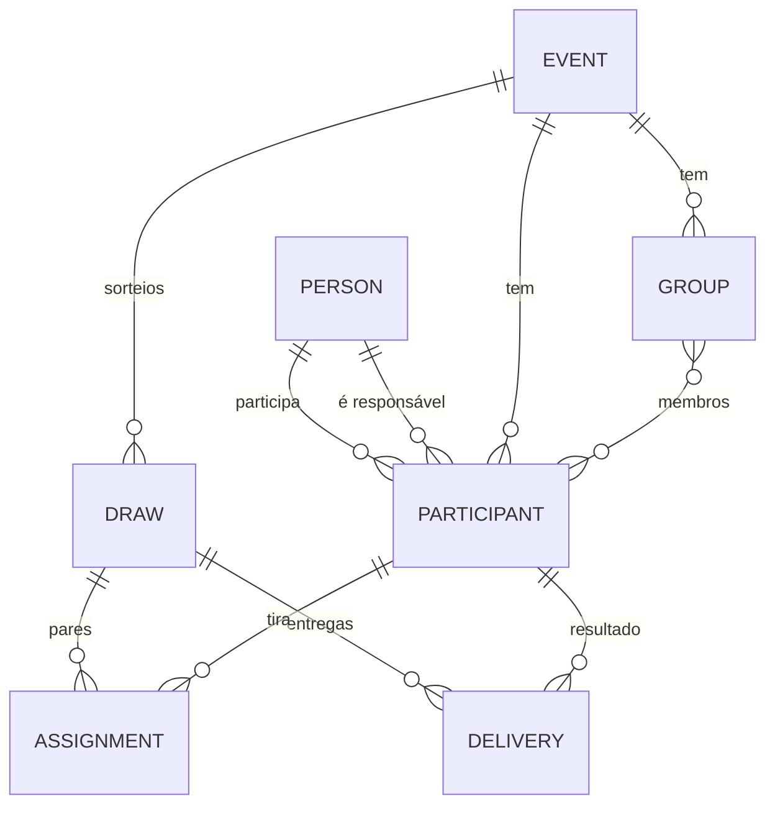

# Arquitetura

## 1. Princípios

- **Local-first:** os dados vivem no dispositivo; não há backend no MVP.
- **Separação de responsabilidades:** interface, regras de negócio e persistência têm limites claros, sem camadas cerimoniais.
- **Domínio testável:** sorteio, telefone, destinatário e mensagem são Dart puro, sem widgets, banco ou WhatsApp.
- **Uma fonte de verdade por assunto:** requisitos definem comportamento; este documento define estrutura e decisões técnicas.
- **Simplicidade proporcional:** poucas dependências, sem code generation e sem injeção de dependência externa.

## 2. Plataforma

### 2.1 Decisão: Flutter Web primeiro, Android depois

| Critério | Flutter Web (PWA) | Android |
| --- | --- | --- |
| Instalação para desenvolver | Flutter SDK + navegador | Flutter SDK + JDK + Android SDK + Gradle |
| Distribuição | URL estática; instalação opcional como PWA | APK assinado, sideload ou loja |
| WhatsApp | `wa.me` abre o app no celular e WhatsApp Web/Desktop no computador | `wa.me` abre diretamente o app do WhatsApp |
| Armazenamento | IndexedDB; pode ser limpo pelo navegador | Arquivo no diretório do app; mais durável, mas some ao desinstalar |
| Funciona offline | Depois do primeiro carregamento, se PWA configurada | Sim, nativo |
| Atualização | Recarregar a página/publicar nova versão | Instalar novo APK |
| Teste | Chrome/Edge; emulação de viewport | Emulador ou aparelho físico |
| Limitações principais | Sem sincronização, cota do navegador, pop-ups, WhatsApp Web precisa de sessão | Toolchain pesado, assinatura, sem iOS |
| Recomendação | **Plataforma inicial** | Evolução do mesmo código, após o MVP Web |

**Por que Web primeiro:** o objetivo é uma solução simples de instalar, manter e usar. A Web elimina JDK, Android SDK, emulador, assinatura e distribuição de APK na primeira entrega, e ainda permite usar o celular pelo navegador. O link universal do WhatsApp funciona nos dois cenários.

**Quando reconsiderar:** se o uso principal for em celular sem depender de navegador, se o armazenamento do navegador for um risco inaceitável ou se a integração nativa com o WhatsApp for um requisito. Nesses casos, Android passa a ser a plataforma inicial e a Fase 1 inclui o toolchain Android.

**Não usar backend agora:** não há necessidade comprovada de sincronização, multiusuário, autenticação ou confirmação de entrega. Um backend adicionaria custo, LGPD, disponibilidade e superfície de ataque. Reavaliar se o produto evoluir para múltiplos organizadores, sincronização entre dispositivos ou envio por API oficial.

### 2.2 Web

- Build estático com `flutter build web --release`.
- Estratégia de URL padrão (hash) para funcionar em hospedagem estática sem regras de rewrite. URLs bonitas com path strategy ficam como melhoria.
- PWA opcional: manifesto, ícones e service worker gerados no build; a instalação varia por navegador.
- Sem service worker customizado no MVP; se adicionado, cuidar de cache de versões para não servir código antigo.
- O app deve funcionar em Chrome/Edge atuais. Safari/iOS não é alvo de aceite do MVP.

### 2.3 Android (fase posterior)

- Mesmo código Dart; adicionar a plataforma Android quando autorizado.
- Usar `path_provider` para o banco e `url_launcher` para o link.
- Requer JDK e Android SDK compatíveis com a versão do Flutter; ver `docs/AMBIENTE.md`.
- Sem iOS no MVP.

## 3. Camadas

```
┌─────────────────────────────────────────────┐
│ UI (Views + ViewModels/Notifiers)           │
│ widgets, formulários, rotas, estados de tela │
└──────────────────┬──────────────────────────┘
                   │ casos de uso / repositórios
┌──────────────────▼──────────────────────────┐
│ Domínio (Dart puro)                         │
│ sorteio, restrições, telefone, destinatário │
│ mensagem, validações, modelos               │
└──────────────────┬──────────────────────────┘
                   │ interfaces de repositório
┌──────────────────▼──────────────────────────┐
│ Dados                                       │
│ Sembast, migrations, backup, repositórios   │
└──────────────────┬──────────────────────────┘
                   │ plataforma
┌──────────────────▼──────────────────────────┐
│ Serviços de plataforma                      │
│ url_launcher, file_picker, path_provider    │
└─────────────────────────────────────────────┘
```

- **UI:** não calcula sorteio, não resolve telefone e não monta URL manualmente. Consome notifiers/providers e exibe estados.
- **Domínio:** funções e modelos puros; sem `BuildContext`, sem plugins.
- **Dados:** repositórios com transações, serialização e validação de integridade.
- **Serviços:** wrappers finos para plugins, injetáveis e substituíveis em testes.

Não haverá uma camada de “use cases” para cada operação. Casos de uso existirão apenas quando combinarem repositórios ou regras não triviais (por exemplo, confirmar sorteio, invalidar, importar backup).

## 4. Estado e navegação

### 4.1 Riverpod 3, sem code generation

- `ProviderScope` na raiz.
- Providers para banco, relógio, gerador de IDs, launcher, file picker e repositórios.
- `AsyncNotifier`/`Notifier` para estado de tela e comandos.
- `AsyncValue` para carregamento/erro; a UI trata os três estados.
- Providers familiares por `eventId` para participantes, grupos, sorteio e entregas.
- Testes usam `ProviderContainer` e overrides; sem `get_it` ou service locator.

Motivos: testabilidade, dependências explícitas, bom suporte a estados assíncronos e nenhuma geração de código. Alternativas consideradas: `provider` (simples, mas menos adequado a estados assíncronos compostos), BLoC (robusto, porém mais cerimônia para o tamanho do app) e `ValueNotifier` puro (não escala para o fluxo completo).

### 4.2 go_router

Rotas previstas:

| Rota | Tela |
| --- | --- |
| `/` | Lista de eventos |
| `/events/new` | Criar evento |
| `/events/:eventId` | Visão geral do evento |
| `/events/:eventId/edit` | Editar evento |
| `/events/:eventId/participants` | Participantes |
| `/events/:eventId/participants/new` | Novo participante |
| `/events/:eventId/participants/:participantId/edit` | Editar participante |
| `/events/:eventId/groups` | Grupos e restrições |
| `/events/:eventId/review` | Revisão e pendências |
| `/events/:eventId/draw` | Sorteio e resultado |
| `/events/:eventId/deliveries` | Fila de envio |
| `/settings` | Configurações |
| `/backup` | Exportar/importar |

- `ShellRoute` para o layout do evento: `NavigationBar` em telas estreitas e `NavigationRail` em telas largas.
- Guardas de rota: evento inexistente → estado de erro com voltar; sorteio inexistente → revisão.
- Formulários sujos usam `PopScope` para confirmar saída.
- Na Web, a estratégia de URL padrão evita configuração de servidor; links internos continuam funcionando.

## 5. Persistência

### 5.1 Escolha: Sembast

**Sembast** é um banco de documentos embarcado, com transações, armazenamento em arquivo no IO e IndexedDB na Web via `sembast_web`.

Por que não as alternativas:

- `shared_preferences`: a documentação oficial alerta que não serve para dados críticos; não oferece transações nem consultas. Seria arriscado para o sorteio.
- SQLite/`drift`: robusto e relacional, mas exige configuração de WASM/worker na Web e code generation/migrations mais pesadas para um app pequeno. É a alternativa se o modelo crescer muito.
- `hive`/key-value: simples, mas sem transações relacionais e com semântica de consistência menos adequada ao sorteio.
- Backend/Firestore: desnecessário e contrário ao requisito de simplicidade.

O volume é pequeno (centenas de pessoas/entregas), e o banco inteiro cabe em memória. Transações e backup em JSON atendem ao MVP.

### 5.2 Abertura e plataforma

- `lib/core/database/database_factory.dart` faz import condicional:
  - IO: `databaseFactoryIo.openDatabase(<documentos>/amigo_secreto/amigo_secreto.db)`;
  - Web: `databaseFactoryWeb.openDatabase('amigo_secreto')`.
- `path_provider` é importado apenas no arquivo IO; `sembast_web` apenas no arquivo Web.
- O banco é aberto antes de `runApp`; em falha, exibir tela de erro com opção de importar backup, sem apagar dados automaticamente.
- Na Web, a base é vinculada à origem. Durante o desenvolvimento, usar sempre a mesma porta para não “perder” os dados.

### 5.3 Stores

| Store | Conteúdo |
| --- | --- |
| `meta` | Versão do schema, versão do app, data de criação. |
| `people` | Pessoas reutilizáveis. |
| `events` | Eventos. |
| `participants` | Participações por evento. |
| `groups` | Grupos e membros. |
| `draws` | Sorteios (ativos e invalidados). |
| `assignments` | Pares giver → receiver de cada sorteio. |
| `deliveries` | Mensagens e estados de envio. |
| `settings` | Preferências locais (tema, país padrão, onboarding). |

Chaves são IDs UUID em string. Consultas pequenas carregam o conjunto do evento e filtram em memória; índices só se medições mostrarem necessidade.

### 5.4 Transações e concorrência

- Toda operação que altera mais de um registro usa `db.transaction`.
- O sorteio é gravado em uma transação com: `draw`, `assignments`, `deliveries` e `event.activeDrawId`.
- O candidato é calculado fora da transação. A transação apenas verifica e persiste o candidato já pronto, o que a torna idempotente.
- Verificações dentro da transação:
  - evento existe e está em rascunho (`activeDrawId == null`);
  - `event.pairingRevision` é igual à revisão usada no cálculo;
  - não existe sorteio com o mesmo ID e conteúdo diferente.
- Se a transação for repetida pela Web, o mesmo payload é gravado; não há novo sorteio.
- `sembast_web` sincroniza abas e exige transações idempotentes. O app não deve ser usado em duas abas para editar o mesmo evento ao mesmo tempo; a revisão detecta conflito.
- Em caso de falha, nada parcial é mantido e o evento continua em rascunho.

### 5.5 Migrations

- `schemaVersion` atual é `3`: versão 1 criou `meta`; versão 2 registrou os stores de `people`, `events`, `participants` e `groups`; versão 3 adicionou `draws`, `assignments` e `deliveries`.
- Migrations são funções explícitas e testadas, executadas antes de abrir a UI. As migrações 1→2 e 2→3 não transformam registros existentes.
- Backup tem `schemaVersion` próprio; importar versão mais nova é rejeitado com mensagem clara.
- Nunca “adivinhar” campos ausentes em produção: validar e migrar.

### 5.6 Limites do armazenamento

- Web: IndexedDB, cota variável por navegador; dados pequenos, mas sujeitos a limpeza/evicção. Não há sincronização.
- Android: arquivo no diretório do app; sobrevive a reinícios, mas não a desinstalação.
- Backup é a única recuperação. O app deve lembrar o organizador de exportar após o sorteio e antes de limpar dados.
- Não usar `localStorage` para dados principais.
- Não prometer persistência eterna; documentar e avisar na interface.

## 6. Modelo de dados

### 6.1 Diagrama



### 6.2 Entidades

#### Person

| Campo | Tipo | Regra |
| --- | --- | --- |
| `id` | String (UUID) | Estável, imutável. |
| `name` | String | Obrigatório, 1–120 caracteres. |
| `nickname` | String? | Opcional, 1–40. |
| `phoneE164` | String? | Opcional; `+` e dígitos; validado. |
| `createdAt` | DateTime UTC | Auditoria. |
| `updatedAt` | DateTime UTC | Auditoria. |

Uma pessoa pode existir sem participação (contato/responsável). Editar uma pessoa referenciada por evento com sorteio ativo é bloqueado.

#### Event

| Campo | Tipo | Regra |
| --- | --- | --- |
| `id` | String (UUID) | Estável. |
| `name` | String | Obrigatório. |
| `eventDate` | DateTime? | Data opcional, sem fuso relevante. |
| `defaultCountryCode` | String | `BR` no MVP. |
| `messageTemplate` | String | Modelo com variáveis; até 2.000 caracteres. |
| `activeDrawId` | String? | Sorteio ativo, se houver. |
| `pairingRevision` | int | Incrementa quando o conjunto/restrições mudam. |
| `createdAt` | DateTime UTC | Auditoria. |
| `updatedAt` | DateTime UTC | Auditoria. |

Situação exibida é derivada de `activeDrawId` e das entregas; não é um campo persistido sujeito a inconsistência.

#### Participant

| Campo | Tipo | Regra |
| --- | --- | --- |
| `id` | String (UUID) | Estável. |
| `eventId` | String | FK para Event. |
| `personId` | String | FK para Person. |
| `isActive` | bool | Padrão `true`. |
| `guardianPersonId` | String? | FK para Person; não pode ser a mesma pessoa. |
| `createdAt` | DateTime UTC | Auditoria. |
| `updatedAt` | DateTime UTC | Auditoria. |

Restrição: `(eventId, personId)` único.

#### Group

| Campo | Tipo | Regra |
| --- | --- | --- |
| `id` | String (UUID) | Estável. |
| `eventId` | String | FK para Event. |
| `name` | String | Obrigatório; único no evento (case-insensitive). |
| `type` | String | `family`, `couple`, `other`. |
| `restrictionEnabled` | bool | Padrão `true`. |
| `memberParticipantIds` | List<String> | Somente participantes do evento. |
| `createdAt` | DateTime UTC | Auditoria. |
| `updatedAt` | DateTime UTC | Auditoria. |

Uma pessoa pode estar em vários grupos. A restrição é a união dos grupos com `restrictionEnabled == true`.

#### Draw

| Campo | Tipo | Regra |
| --- | --- | --- |
| `id` | String (UUID) | Gerado antes da transação. |
| `eventId` | String | FK para Event. |
| `createdAt` | DateTime UTC | Momento da confirmação. |
| `algorithmVersion` | int | Ex.: `1`. |
| `pairingRevision` | int | Revisão usada no cálculo. |
| `status` | String | `active` ou `invalidated`. |
| `invalidatedAt` | DateTime? | Quando invalidado. |

#### Assignment

| Campo | Tipo | Regra |
| --- | --- | --- |
| `id` | String (UUID) | Estável. |
| `drawId` | String | FK para Draw. |
| `eventId` | String | Facilita consultas. |
| `giverParticipantId` | String | Único por sorteio. |
| `receiverParticipantId` | String | Único por sorteio. |

Restrições: `(drawId, giverParticipantId)` único; `(drawId, receiverParticipantId)` único; giver ≠ receiver.

#### Delivery

| Campo | Tipo | Regra |
| --- | --- | --- |
| `id` | String (UUID) | Estável. |
| `drawId` | String | FK para Draw. |
| `assignmentId` | String | FK para Assignment. |
| `eventId` | String | Consultas. |
| `ownerParticipantId` | String | Dono do resultado. |
| `recipientKind` | String | `self` ou `guardian`. |
| `recipientPersonId` | String? | Responsável, quando houver. |
| `recipientNameSnapshot` | String | Nome do destinatário no momento da criação. |
| `recipientPhoneSnapshot` | String? | E.164 resolvido; nulo se sem contato. |
| `channel` | String | `whatsapp` ou `manual`. |
| `status` | String | `pending`, `opened`, `confirmed`. |
| `messageSnapshot` | String | Mensagem resolvida no momento da criação/atualização. |
| `ownerNameSnapshot` | String | Nome completo do dono. |
| `drawnNameSnapshot` | String | Nome/apelido da pessoa sorteada. |
| `createdAt` | DateTime UTC | Auditoria. |
| `openedAt` | DateTime? | Quando o link foi aberto. |
| `confirmedAt` | DateTime? | Confirmação manual. |
| `confirmationMethod` | String? | `whatsapp` ou `manual`. |

Falha ao abrir não é persistida como estado separado: a entrega permanece `pending` e a interface oferece copiar a mensagem. Ao reabrir uma conversa já confirmada, a confirmação e seu método são preservados.

Snapshots protegem o que foi efetivamente mostrado/enviado. Se o modelo mudar, apenas entregas `pending` podem ser atualizadas com ação explícita.

### 6.3 Invariantes

- Todo participante pertence a exatamente um evento e a uma pessoa.
- Todo grupo pertence ao evento dos seus membros.
- Todo assignment pertence a um draw do mesmo evento.
- Todo draw ativo é referenciado por no máximo um evento.
- Nenhum evento tem dois draws ativos.
- Toda delivery pertence a um assignment do mesmo draw.
- Nenhum par viola restrição ativa.
- Nenhum giver é igual ao receiver.
- Telefones armazenados estão em E.164 ou nulos.

## 7. Motor de sorteio

### 7.1 Entrada e saída

Entrada pura:

- IDs dos participantes ativos;
- pares proibidos (derivados dos grupos com restrição ativa);
- fonte de aleatoriedade injetável.

Saída:

- sucesso com lista `giverId → receiverId`;
- falha com motivos legíveis e dados para diagnóstico;
- nunca altera dados.

### 7.2 Verificação de existência

1. Montar grafo bipartido com givers e receivers ativos.
2. Criar aresta quando `giver != receiver` e o par não é proibido.
3. Calcular matching máximo (Hopcroft–Karp).
4. Se o matching máximo < n, não há solução.
5. Gerar diagnóstico:
   - participantes sem nenhuma opção;
   - grupo restrito com mais da metade dos ativos;
   - testar, sem salvar, a desativação individual de cada grupo restrito para indicar quais ajustes tornariam o sorteio possível;
   - mensagem genérica quando a causa é uma combinação de restrições.

A verificação de matching é completa; as mensagens são explicativas, não uma prova minimal de impossibilidade.

### 7.3 Amostragem uniforme

Algoritmo:

1. Obter um matching perfeito inicial `M` (Hopcroft–Karp).
2. Processar os givers em ordem fixa.
3. Para o giver atual `g`, seja `r0 = M(g)`.
4. Construir o grafo alternado do conjunto restante: arestas não pertencentes a `M` de giver → receiver; arestas de `M` de receiver → giver.
5. Um receiver `r` é viável se:
   - `r == r0`; ou
   - `(g, r)` é permitida e o giver atualmente casado com `r` alcança `r0` no grafo alternado.
6. Escolher uniformemente entre os receivers viáveis.
7. Se `r != r0`, inverter o caminho alternado entre o giver deslocado e `r0`; depois casar `g` com `r`.
8. Remover `g` e `r` do conjunto e repetir.

Por que é uniforme: com a ordem de givers fixa, cada matching perfeito corresponde a exatamente uma sequência de escolhas. Em cada passo, o conjunto de candidatos que preserva a existência de solução não depende do matching escolhido, apenas do conjunto restante; escolher uniformemente entre eles dá a mesma probabilidade a todas as soluções.

Complexidade: matching inicial `O(E√V)`; cada passo constrói grafo alternado e faz busca `O(E)`; total `O(nE)`. Para 200 participantes, é adequado.

Limitações:

- uniformidade entre soluções válidas, não entre formatos de ciclos;
- não evita repetição de pares de eventos anteriores;
- não pondera gênero, idade ou afinidade;
- não exige ciclo único.

### 7.4 Por que não tentativas aleatórias

Tentar permutações até achar uma válida pode ser exponentialmente lento, falhar sem explicar e enviesar a distribuição. A abordagem de matching garante existência e respeita todas as regras; a amostragem por caminhos alternados mantém uniformidade sem força bruta.

### 7.5 Persistência do resultado

- O candidato é calculado e validado fora da transação.
- A confirmação grava o candidato já pronto, com ID de sorteio gerado antes.
- A transação verifica `pairingRevision` e `activeDrawId`.
- As entregas são criadas com snapshots de destinatário, telefone e mensagem.
- Se a gravação falhar, o candidato é descartado e o evento continua em rascunho.

## 8. Fluxos

### 8.1 Cadastro de participante

1. UI abre formulário com dados da pessoa (novo ou existente).
2. Valida nome, apelido e telefone.
3. Permite criar grupo inline; o grupo é salvo e o formulário continua com os dados.
4. Ao salvar, repositório grava pessoa (se nova), participante, vínculo de responsável e grupos em transação.
5. Avisos de duplicidade são calculados antes/depois, sem bloquear.
6. A lista é atualizada via provider.

### 8.2 Revisão antes do sorteio

1. Carregar participantes ativos, grupos, responsáveis e telefones.
2. Calcular avisos: sem contato, responsável sem telefone, nomes/telefones repetidos, menos de 2 ativos.
3. Rodar verificação de viabilidade sem salvar.
4. Se inviável, explicar e sugerir ajustes; não permitir confirmar.
5. Se viável, liberar “Sortear”.

### 8.3 Sorteio e confirmação

1. Organizador toca “Sortear”.
2. App calcula candidato com `pairingRevision` atual.
3. Mostra resumo e pede confirmação.
4. Ao confirmar, transação grava draw, assignments e deliveries.
5. UI navega para resultado; cards ocultos.
6. Se falhar, mostra erro e mantém rascunho.

### 8.4 Envio

1. Fila carrega entregas do draw ativo.
2. Cada cartão resolve dono, destinatário e telefone a partir dos snapshots.
3. “Abrir WhatsApp” monta `wa.me` e chama o launcher.
4. Sucesso → `opened` (se pendente); falha → permanece pendente e a interface oferece cópia.
5. Organizador volta e confirma manualmente → `confirmed` com método; isso registra a confirmação do organizador, não prova entrega ou leitura.
6. O editor salva o modelo em transação e só reescreve snapshots `pending` quando o organizador escolhe atualizar; mensagens `opened` ou `confirmed` mantêm o conteúdo anterior.
7. Nenhum estado é inferido como entrega/leitura.

### 8.5 Invalidação

1. Organizador tenta editar dados bloqueados ou toca “Invalidar sorteio”.
2. App mostra impacto: mensagens abertas/confirmadas.
3. Confirmação explícita.
4. Transação marca draw como `invalidated`, limpa `event.activeDrawId`, mantém assignments/deliveries históricos.
5. Evento volta a rascunho; novo sorteio cria novos registros.

### 8.6 Backup

1. Exportar: ler stores, montar JSON versionado, salvar via `file_picker`.
2. Importar: escolher arquivo, limitar tamanho, validar schema/referências, mostrar resumo.
3. Confirmar → transação substitui todos os stores.
4. Reabrir providers e navegar para a lista de eventos.
5. Nunca logar conteúdo.

## 9. Dependências previstas

Versões de referência em 2026-11-03; a Fase 1 deve registrar as versões efetivamente instaladas no `pubspec.lock`.

| Pacote | Versão de referência | Uso | Obrigatório |
| --- | --- | --- | --- |
| Flutter SDK | 3.47.9 stable (Dart 3.13.7) | SDK | Sim |
| `flutter_riverpod` | ^3.4.3 | Estado e DI | Sim |
| `go_router` | ^18.1.2 | Navegação | Sim |
| `sembast` | ^3.10.0 | Banco local | Sim |
| `sembast_web` | ^2.4.6+1 | Banco na Web | Sim |
| `path_provider` | ^2.1.6 | Diretório do banco no IO | Sim (IO) |
| `url_launcher` | ^6.3.3 | Abrir WhatsApp | Sim |
| `phone_numbers_parser` | ^9.0.29 | Validar/normalizar telefone | Sim |
| `uuid` | ^4.6.0 | IDs estáveis | Sim |
| `intl` | ^0.20.3 | Datas em pt-BR | Sim |
| `file_picker` | ^13.3.2 | Backup export/import | Sim |
| `flutter_localizations` | SDK | Textos Material em pt-BR | Sim |
| `flutter_lints` | ^6.0.0 | Lint | Desenvolvimento |
| `flutter_test` | SDK | Testes | Desenvolvimento |
| `integration_test` | SDK | Testes de integração | Desenvolvimento |

Observações:

- `phone_numbers_parser` é Dart puro e funciona na Web; não exige plugin nativo. É mantido por terceiros; validar na Fase 1 e isolar atrás de um value object para permitir troca.
- `file_picker` v13 tem API diferente das versões antigas; usar `pickFile`, `saveFile` e `readAsBytes`.
- Não adicionar `shared_preferences`, `get_it`, `freezed`, `json_serializable` ou `drift` sem necessidade demonstrada.
- `pubspec.lock` deve ser commitado por ser aplicativo.

## 10. Estrutura de pastas proposta

```text
AmigoSecreto/
  lib/
    main.dart
    app/
      app.dart
      router.dart
      theme.dart
      bootstrap.dart
    core/
      database/
        app_database.dart
        database_factory.dart
        database_factory_io.dart
        database_factory_web.dart
        migrations.dart
      errors/
        app_error.dart
      ids/
        id_generator.dart
      phone/
        phone_number.dart
      time/
        clock.dart
    features/
      events/
        data/event_repository.dart
        domain/event.dart
        presentation/...
      participants/
        data/person_repository.dart
        data/participant_repository.dart
        domain/person.dart
        domain/participant.dart
        domain/guardian_resolver.dart
        presentation/...
      groups/
        data/group_repository.dart
        domain/group.dart
        domain/restriction_graph.dart
        presentation/...
      draw/
        domain/draw_engine.dart
        domain/draw_models.dart
        data/draw_repository.dart
        presentation/...
      delivery/
        domain/message_template.dart
        domain/recipient_resolver.dart
        domain/whatsapp_link.dart
        data/delivery_repository.dart
        presentation/...
      backup/
        data/backup_service.dart
        presentation/...
      settings/
        ...
    shared/
      widgets/
      layout/
  test/
    core/
    features/
  integration_test/
  docs/
    decisions/
  web/
  pubspec.yaml
```

A estrutura pode ser ajustada na Fase 1, mas a separação domínio/dados/UI e a pureza do motor de sorteio não devem ser quebradas.

## 11. Serviços e abstrações

Para testabilidade, injetar atrás de interfaces:

- `Clock` (`DateTime now()`), para timestamps determinísticos.
- `IdGenerator` (`String newId()`), para IDs previsíveis em testes.
- `WhatsAppLauncher` (`Future<LaunchResult> open(Uri)`), para não abrir WhatsApp em testes.
- `BackupFileService` (`Future<Uri?> save(...)`, `Future<Uint8List?> pick(...)`), para simular arquivos.
- `DatabaseFactory`/`Database`, para usar banco em memória nos testes.
- `Random`, para o motor de sorteio.

Não criar interfaces para tudo; apenas para bordas de plataforma ou aleatoriedade/tempo.

## 12. Erros e mensagens

- Erros esperados de negócio (sorteio impossível, telefone inválido, conflito de revisão) são resultados tipados, não exceções genéricas.
- Erros de infraestrutura (banco, arquivo, launcher) são capturados na borda e convertidos em mensagem amigável.
- Mensagens de erro não incluem telefone, nome completo, resultado ou stack trace.
- Logs de desenvolvimento, se existirem, não recebem dados pessoais.
- Toda falha de gravação deve indicar que nada foi salvo e oferecer tentar novamente/exportar backup.

## 13. Segurança e privacidade

- Sem backend, sem analytics, sem telemetria, sem anúncios.
- A única navegação externa é o link do WhatsApp; nenhum dado é enviado a um servidor do app.
- Dados em IndexedDB/arquivo local sem criptografia. A segurança depende do acesso ao dispositivo/navegador.
- Se a versão Web for publicada, qualquer pessoa com a URL pode carregar o app, mas não acessa os dados de outra pessoa; os dados são da origem local.
- Não colocar dados pessoais em URLs, nomes de arquivos, logs ou mensagens de erro.
- Backups são sensíveis; avisar e nunca enviar automaticamente.
- Sem autenticação/PIN no MVP; um PIN local não substituiria criptografia e pode dar falsa sensação de segurança. Reavaliar no futuro.

## 14. Acessibilidade e responsividade

- Material 3, tipografia legível, contraste AA.
- Breakpoints: compacto `< 600 px`, médio `600–1024 px`, expandido `> 1024 px`.
- Navegação inferior no compacto; rail no médio/expandido.
- Formulários em coluna única no compacto e duas colunas no expandido quando fizer sentido.
- Sem tabelas horizontalmente roláveis para dados essenciais no celular.
- Diálogos com foco preso, rótulos claros e ação destrutiva diferenciada.
- Testar com escala de texto 200% e leitor de tela nos fluxos principais.

## 15. Decisões relacionadas

- `docs/decisions/ADR-001-plataforma-inicial.md`
- `docs/decisions/ADR-002-persistencia-local.md`
- `docs/decisions/ADR-003-algoritmo-sorteio.md`
- `docs/decisions/ADR-004-envio-whatsapp.md`
- `docs/decisions/ADR-005-pessoa-e-participante.md`
